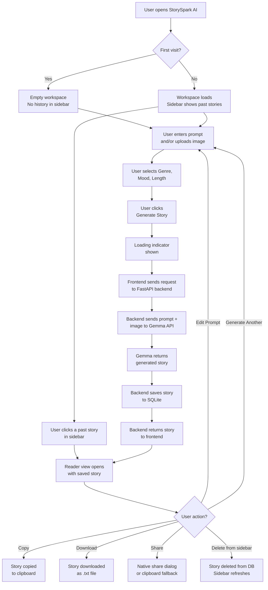
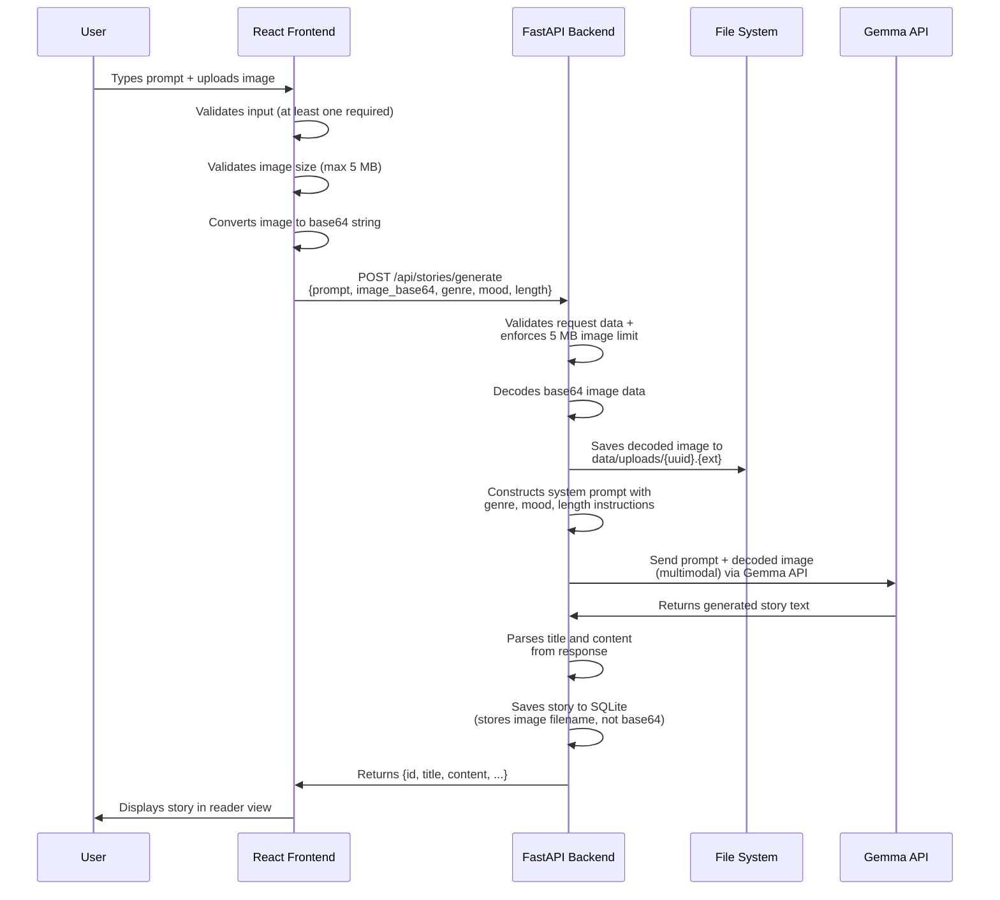
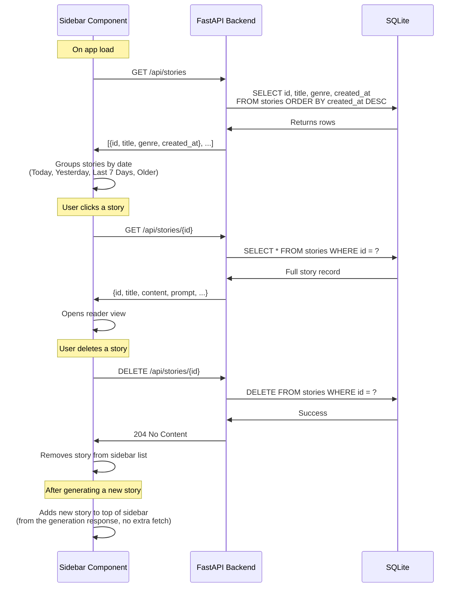
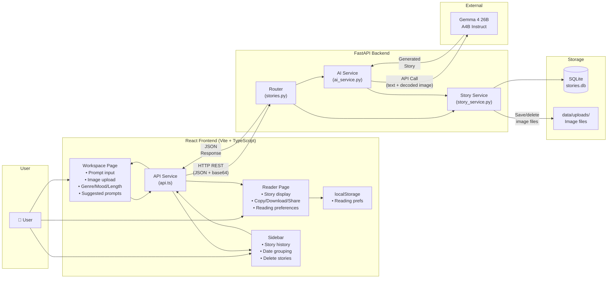

# StorySpark AI — Phase 1: Project Understanding, Architecture & Development Plan

> **Where Ideas Become Stories**

---

## 1. What Exactly We Are Building

StorySpark AI is a **full-stack AI-powered storytelling web application** with two distinct parts:

| Layer | Technology | Purpose |
|-------|-----------|---------|
| **Frontend** | React + TypeScript + Vite + Tailwind CSS | The user interface — where users write prompts, upload images, choose preferences, read stories, and browse history |
| **Backend** | Python + FastAPI | The API server — receives requests from the frontend, talks to the AI model, stores/retrieves stories from the database |
| **AI Model** | Google Gemma 4 26B A4B Instruct (`gemma-4-26b-a4b-it`) | The story engine — generates complete, coherent stories from text and/or image inputs |
| **Database** | SQLite | Persistent storage — saves every generated story so users can revisit them across sessions |

The application is **not** a chat interface. It is a **single-purpose creative tool**: the user provides input and preferences, presses a button, and receives a fully-formed story.

---

## 2. How the Application Works — User's Perspective

### The Workspace (Home Screen)

When the user opens StorySpark AI, they see:

1. **A left sidebar** showing their previous stories grouped by date (Today, Yesterday, Last 7 Days, Older).
2. **A central workspace** with:
   - A text area to type a story prompt.
   - An image upload zone (drag & drop or click to select).
   - Suggested prompt chips for inspiration.
   - Dropdowns/selectors for Genre, Mood, and Story Length.
   - A "Generate Story" button.

### The Generation Flow

1. User types a prompt and/or uploads an image.
2. User selects genre (e.g., Fantasy, Sci-Fi, Mystery), mood (e.g., Whimsical, Dark, Heartwarming), and length (Short, Medium, Long).
3. User clicks "Generate Story."
4. A loading state appears while the backend calls Gemma.
5. The generated story appears in a **reader view** with its title.

### The Reader View

Once a story is generated, the user can:

- **Read** the full story with customizable font style and size.
- **Copy** the story to clipboard.
- **Download** it as a `.txt` file.
- **Share** it via the device's native share dialog (with clipboard fallback).
- **Edit Prompt** — go back to the workspace with the original prompt pre-filled.
- **Generate Another** — return to a fresh workspace.
- **Navigate back** to the workspace via a back button or sidebar.

### The Sidebar

- Always visible on desktop; toggleable on mobile.
- Shows all past stories with their titles, grouped by date.
- Clicking a story opens it in the reader view.
- Each story has a delete button.
- History persists across browser refreshes and app restarts (stored in SQLite on the backend).

### Reading Customization

- A settings control (gear icon or similar) lets users pick font family and adjust font size.
- Preview updates in real-time.
- Preferences are saved in `localStorage` so they survive between visits without needing backend calls.

---

## 3. Complete User Journey



---

## 4. Responsibilities of Each Layer

### Frontend (React + TypeScript)

| Responsibility | Details |
|---------------|---------|
| Prompt input | Text area with character guidance |
| Image handling | File input, preview thumbnail, validate file size (max 5 MB), convert to base64 for API transmission |
| Preference selection | Genre / Mood / Length dropdowns or button groups |
| Input validation | Ensure at least one input (text or image) is provided before submission |
| API communication | Send story generation requests; fetch/delete history |
| Story display | Render the story in a clean reader view |
| History sidebar | Fetch and display past stories grouped by date |
| Reader actions | Copy, download, share, edit prompt, generate another |
| Reading preferences | Font family/size selector, save to `localStorage` |
| Responsive layout | Adapt for desktop, tablet, and mobile |
| Loading & error states | Show spinners during generation; show error messages on failure |

### Backend (FastAPI)

| Responsibility | Details |
|---------------|---------|
| REST API endpoints | Expose routes for story generation, history listing, story retrieval, story deletion |
| Request validation | Validate incoming data using typed Pydantic schemas (prompt text, image format/size, genre/mood/length values). Enforce 5 MB image size limit |
| AI integration | Build the Gemma prompt, send the request (with image if verified supported), parse the response |
| Image processing | Receive base64 image from frontend, validate and decode, save decoded file to `data/uploads/`, pass decoded image to Gemma's multimodal input. Store only the filename in SQLite — never the base64 data |
| Database operations | Save new stories, query history, delete stories (and associated image files) |
| Error handling | Handle: invalid API key (401), quota exceeded (429), network timeout (504), empty/incomplete AI response (502), unsupported image (422), oversized image (413), database save failure (500). Never return a success response when persistence fails |
| Configuration | Manage API key, model ID, CORS settings via environment variables |

### AI Model (Gemma 4 26B A4B Instruct)

| Responsibility | Details |
|---------------|---------|
| Story generation | Accept a crafted prompt (with genre, mood, length instructions) and return a complete story |
| Multimodal input | Accept both text and image inputs — **must be verified with real API tests before claiming support** |
| Title generation | Generate an appropriate title as part of the response |
| Content quality | Produce coherent, non-repetitive stories with clear structure |

### Database (SQLite)

| Responsibility | Details |
|---------------|---------|
| Story persistence | Store generated stories with metadata |
| Schema | `stories` table with: id, title, content, prompt, image_filename (optional), genre, mood, length, created_at (UTC) |
| Querying | Support listing all stories (for sidebar), fetching a single story, and deletion |

---

## 5. How Text and Image Inputs Reach Gemma



**Image transmission versus storage — two separate operations:**

1. **Transmission** (frontend → backend): The frontend converts the selected image file to a **base64 string** and sends it inside the JSON request body. This is how the image travels over HTTP.
2. **Processing** (backend): The backend **validates** the base64 data (format, size), then **decodes** it back to raw image bytes.
3. **Storage** (backend → file system): The decoded image is saved as a file in `backend/data/uploads/` with a UUID filename (e.g., `a1b2c3d4.jpg`). The base64 data is discarded after decoding.
4. **Database reference**: SQLite stores **only the filename** in the `image_filename` column — never the base64 data or raw image bytes. This keeps the database lean.
5. **AI forwarding**: The decoded image bytes (not the stored file) are passed directly to the Gemma API as multimodal input during the same request.

**Key details:**

- **Text-only**: The backend sends only the text prompt to Gemma. No image is stored.
- **Image-only** *(if verified supported in Phase 4)*: The backend saves the image file, sends the decoded image to Gemma with a generic "describe and create a story inspired by this image" prompt.
- **Both** *(if verified supported in Phase 4)*: The backend saves the image file, sends both text and decoded image to Gemma, telling it to weave the image's content into the story guided by the text prompt.
- **Size limit**: Maximum image upload size is **5 MB**. Validated on both frontend (before submission) and backend (before processing).

> [!IMPORTANT]
> **Gemma Image-Input Verification Requirement**
>
> Before building image-based story generation, we must **verify** that the exact Gemma model (`gemma-4-26b-a4b-it`) and the selected API provider/configuration actually support multimodal (image) input. This verification must happen during Phase 4 (AI Integration) with real API calls — not assumptions from documentation alone.
>
> **Verification steps (Phase 4):**
> 1. Send a **text-only** prompt → confirm a story is returned.
> 2. Send an **image-only** request → confirm the API accepts it and returns a story.
> 3. Send a **text + image** request → confirm both are processed together.
>
> Each mode must be tested independently. If the model or API configuration does not support image input, we will:
> - Disable the image upload feature in the UI with a clear message.
> - Proceed with text-only generation.
> - Never claim image understanding works without a successful real test.

---

## 6. How Generated Stories Are Stored and Retrieved

### Storage (on generation)

When Gemma returns a story, the backend **immediately** saves it to SQLite before responding to the frontend. The frontend must **not** report a story as successfully saved unless the backend confirms persistence.

```
stories table
─────────────
id              TEXT (UUID)     — Primary key
title           TEXT            — Extracted from AI response
content         TEXT            — Full story text
prompt          TEXT            — Original user prompt (nullable)
image_filename  TEXT            — Filename of saved image in storage dir (nullable)
genre           TEXT            — Selected genre
mood            TEXT            — Selected mood
length          TEXT            — Selected length (short/medium/long)
created_at      DATETIME        — Timestamp of creation (UTC)
```

> [!NOTE]
> **Image Storage: File System over Database**
>
> Storing base64-encoded images directly in SQLite would bloat the database significantly. A single 2 MB image becomes ~2.7 MB in base64. Over many stories, this degrades query performance, backup size, and database integrity.
>
> **MVP approach:**
> - The frontend sends the image as base64 in the JSON request (transmission format only).
> - The backend **decodes** the base64 data and saves the raw image as a file in `backend/data/uploads/` with a UUID filename (e.g., `a1b2c3d4.jpg`).
> - Only the filename is stored in the `image_filename` column in SQLite — **never the base64 string or raw image bytes**.
> - When a story is deleted, its associated image file is also deleted.
> - The backend serves uploaded images via a static file route or a dedicated endpoint if needed for the reader view.
> - Maximum image upload size: **5 MB**, enforced on both frontend and backend.
>
> This keeps the database lean and the implementation simple.

### Retrieval (for sidebar / reader)

- **Sidebar list**: `GET /api/stories` → returns `[{id, title, genre, created_at}, ...]` (lightweight, no full content).
- **Full story**: `GET /api/stories/{id}` → returns the complete story record.
- **Deletion**: `DELETE /api/stories/{id}` → removes the story from the database and deletes any associated image file.

---

## 7. Sidebar History ↔ Backend Communication



**Date grouping** is performed entirely on the frontend. The backend returns `created_at` timestamps in **UTC**. The frontend converts them to the user's **local timezone** before grouping into Today, Yesterday, Last 7 Days, and Older.

---

## 8. How Reading Preferences Are Saved

Reading preferences (font family, font size) are **lightweight, user-specific, UI-only settings**. They don't need to live in the database.

**Approach: `localStorage`**

```
localStorage key: "storyspark_reading_prefs"
value: { "fontFamily": "Georgia", "fontSize": 18 }
```

- On app load, a custom hook (`useReadingPreferences`) reads from `localStorage`.
- When the user changes a setting, the hook updates state and writes to `localStorage`.
- The reader view component consumes these values to style the story text.
- No backend call is needed. Preferences persist across browser refreshes.

---

## 9. How Copy, Download, and Share Work

All three are **frontend-only** operations — no backend involvement.

| Action | Implementation |
|--------|---------------|
| **Copy** | Use the Clipboard API: `navigator.clipboard.writeText(storyContent)`. Show a brief "Copied!" toast confirmation. |
| **Download** | Create a `Blob` from the story text, generate an object URL with `URL.createObjectURL()`, trigger a download via a temporary `<a>` element with `download` attribute. Filename: `{story-title}.txt`. |
| **Share** | Check for `navigator.share` (Web Share API). If supported, call it with `{ title, text }` to share the story text directly. If not supported (e.g., desktop browsers), fall back to copying the story text to clipboard with a **"Story copied to clipboard!"** message. This application does not generate public shareable URLs — the share action always shares the story text itself. |

---

## 10. Frontend ↔ Backend Communication

### API Contract

All timestamps in API responses are in **UTC** (ISO 8601 format). The frontend converts to local timezone for display.

| Endpoint | Method | Request Body | Response |
|----------|--------|-------------|----------|
| `/api/stories/generate` | POST | `{ prompt?, image_base64?, genre, mood, length }` | `{ id, title, content, prompt, genre, mood, length, created_at }` |
| `/api/stories` | GET | — | `[{ id, title, genre, created_at }, ...]` |
| `/api/stories/{id}` | GET | — | `{ id, title, content, prompt, image_filename?, genre, mood, length, created_at }` |
| `/api/stories/{id}` | DELETE | — | `204 No Content` |

### Typed Pydantic Schemas

All request and response data is validated through **typed Pydantic models** in `backend/app/models.py`:

```
# Request schemas
GenerateStoryRequest:
    prompt:        Optional[str]     — At least one of prompt or image_base64 required
    image_base64:  Optional[str]     — Base64-encoded image data
    genre:         str               — Must be a valid genre value
    mood:          str               — Must be a valid mood value
    length:        str               — "short" | "medium" | "long"

# Response schemas
StoryResponse:
    id:              str
    title:           str
    content:         str
    prompt:          Optional[str]
    image_filename:  Optional[str]
    genre:           str
    mood:            str
    length:          str
    created_at:      datetime         — UTC

StoryListItem:
    id:          str
    title:       str
    genre:       str
    created_at:  datetime             — UTC

ErrorResponse:
    detail:      str                  — Human-readable error message
```

### Communication Pattern

- **Protocol**: HTTP REST (JSON bodies).
- **CORS**: FastAPI configured to allow requests from the Vite dev server (`http://localhost:5173`).
- **Frontend API layer**: A single `api.ts` service file with typed functions for each endpoint, using `fetch`.

### Error Handling Contract

Every error returned by the backend uses the format `{ "detail": "Human-readable error message" }` with an appropriate HTTP status code. The frontend must handle each scenario gracefully:

| Error Scenario | HTTP Status | Backend Behavior | Frontend Behavior |
|---------------|-------------|-----------------|-------------------|
| **Invalid API key** | 401 | Return `{ "detail": "AI service authentication failed. Check API key." }` | Show clear error; do not retry automatically |
| **Quota exceeded** | 429 | Return `{ "detail": "AI service rate limit exceeded. Please try again later." }` | Show error with suggestion to wait |
| **Network timeout** | 504 | Catch timeout from Gemma API call, return `{ "detail": "Story generation timed out. Please try again." }` | Show timeout error with retry option |
| **Empty AI response** | 502 | Detect empty/null response from Gemma, return `{ "detail": "AI returned an empty response. Please try again." }` | Show error with retry option |
| **Incomplete AI response** | 502 | Detect response missing title or content, return `{ "detail": "AI returned an incomplete story. Please try again." }` | Show error with retry option |
| **Unsupported image format** | 422 | Validate image before sending to Gemma, return `{ "detail": "Unsupported image format. Please use JPEG, PNG, or WebP." }` | Show validation error; do not submit |
| **Oversized image upload** | 413 | Enforce 5 MB limit on decoded image size, return `{ "detail": "Image exceeds the 5 MB size limit. Please choose a smaller image." }` | Frontend validates before submission and blocks oversized files; backend enforces the same limit as a safeguard |
| **Database save failure** | 500 | Catch SQLite write error, return `{ "detail": "Failed to save story. Please try again." }` | **Never report the story as saved**; show error clearly |
| **Story not found** | 404 | Return `{ "detail": "Story not found." }` | Navigate back to workspace or show not-found message |
| **Invalid request data** | 422 | Pydantic validation returns field-level errors | Show validation message near the relevant input |
| **Backend unreachable** | — | N/A (frontend cannot reach server) | Show "Cannot connect to server" error |

> [!CAUTION]
> The frontend must **never** display a story as successfully saved if the backend returns an error. If story generation succeeds but database persistence fails, the backend must return a 500 error — not a success response with the generated story. The user should be informed that their story could not be saved and should try again.

---

## 11. Proposed Folder Structure

```
storyspark_react_app/
│
├── frontend/                          # React application
│   ├── public/
│   │   └── favicon.svg                # App icon
│   ├── src/
│   │   ├── assets/                    # Static assets (images, SVGs)
│   │   ├── components/                # Reusable UI components
│   │   │   ├── layout/                # Layout components
│   │   │   │   ├── Sidebar.tsx        # Story history sidebar
│   │   │   │   ├── Header.tsx         # App header / top bar
│   │   │   │   └── AppLayout.tsx      # Main layout wrapper
│   │   │   ├── story/                 # Story-related components
│   │   │   │   ├── PromptInput.tsx    # Text prompt textarea
│   │   │   │   ├── ImageUpload.tsx    # Image upload with preview
│   │   │   │   ├── GenreSelector.tsx  # Genre selection
│   │   │   │   ├── MoodSelector.tsx   # Mood selection
│   │   │   │   ├── LengthSelector.tsx # Story length selection
│   │   │   │   ├── SuggestedPrompts.tsx # Prompt suggestion chips
│   │   │   │   ├── StoryReader.tsx    # Story display / reader
│   │   │   │   └── StoryActions.tsx   # Copy, download, share buttons
│   │   │   └── ui/                    # Generic UI primitives
│   │   │       ├── Button.tsx         # Reusable button
│   │   │       ├── LoadingSpinner.tsx # Loading indicator
│   │   │       ├── Toast.tsx          # Notification toast
│   │   │       └── Modal.tsx          # Modal dialog (if needed)
│   │   ├── pages/                     # Route-level page components
│   │   │   ├── WorkspacePage.tsx      # Story creation workspace
│   │   │   └── ReaderPage.tsx         # Story reader view
│   │   ├── hooks/                     # Custom React hooks
│   │   │   ├── useStoryHistory.ts     # Fetch & manage story history
│   │   │   ├── useStoryGeneration.ts  # Handle story generation flow
│   │   │   └── useReadingPrefs.ts     # Reading preference management
│   │   ├── services/                  # API communication layer
│   │   │   └── api.ts                 # All backend API calls
│   │   ├── types/                     # TypeScript type definitions
│   │   │   └── index.ts              # Shared types (Story, Genre, etc.)
│   │   ├── utils/                     # Utility functions
│   │   │   ├── dateGroups.ts          # Group stories by date
│   │   │   └── fileDownload.ts        # Download helper
│   │   ├── App.tsx                    # Root component with router
│   │   ├── main.tsx                   # Entry point
│   │   └── index.css                  # Global styles / Tailwind directives
│   ├── index.html                     # HTML entry point
│   ├── package.json
│   ├── tsconfig.json
│   ├── vite.config.ts
│   ├── tailwind.config.js
│   └── postcss.config.js
│
├── backend/                           # FastAPI application
│   ├── app/
│   │   ├── __init__.py
│   │   ├── main.py                    # FastAPI app entry, CORS, router mounting
│   │   ├── config.py                  # Environment variables, settings
│   │   ├── database.py                # SQLite connection, table creation
│   │   ├── models.py                  # Pydantic models (request/response schemas)
│   │   ├── routers/
│   │   │   └── stories.py            # Story endpoints (generate, list, get, delete)
│   │   └── services/
│   │       ├── ai_service.py          # Gemma API integration
│   │       └── story_service.py       # Story CRUD operations (DB logic)
│   ├── data/
│   │   ├── stories.db                 # SQLite database file (auto-created)
│   │   └── uploads/                   # Uploaded image files (UUID-named)
│   ├── requirements.txt               # Python dependencies
│   ├── .env.example                   # Example environment variables
│   └── .env                           # Actual env vars (gitignored)
│
├── .gitignore
└── README.md
```

### Key Folder Responsibilities

| Folder | Purpose |
|--------|---------|
| `frontend/src/components/layout/` | Structural components that define the page skeleton (sidebar, header, wrapper) |
| `frontend/src/components/story/` | All components specific to story creation and reading |
| `frontend/src/components/ui/` | Generic, reusable UI primitives with no business logic |
| `frontend/src/pages/` | Top-level page components mapped to routes — they compose layout + feature components |
| `frontend/src/hooks/` | Custom hooks that encapsulate stateful logic (API calls, localStorage, etc.) |
| `frontend/src/services/` | The single interface between frontend and backend — all `fetch` calls live here |
| `frontend/src/types/` | Shared TypeScript interfaces and types used across the app |
| `frontend/src/utils/` | Pure helper functions (no React, no state) |
| `backend/app/routers/` | FastAPI route handlers — thin layer that validates input and calls services |
| `backend/app/services/` | Business logic — AI integration and database operations |
| `backend/app/` root files | App setup (`main.py`), config (`config.py`), DB setup (`database.py`), schemas (`models.py`) |

---

## 12. Architecture Diagram



### Where Each Feature Lives

| Feature | Frontend | Backend | Storage |
|---------|----------|---------|---------|
| Text prompt input | `PromptInput.tsx` | Received in `stories.py` router | — |
| Image upload & preview | `ImageUpload.tsx` | Decoded in `ai_service.py`, saved to `data/uploads/` | Filename in `stories.db` |
| Genre / Mood / Length | `GenreSelector.tsx`, `MoodSelector.tsx`, `LengthSelector.tsx` | Used to craft Gemma prompt in `ai_service.py` | Saved in `stories.db` |
| Suggested prompts | `SuggestedPrompts.tsx` | — | — |
| Story generation | `useStoryGeneration.ts` → `api.ts` | `ai_service.py` → Gemma API | Result saved to `stories.db` |
| Story display | `StoryReader.tsx` | `GET /api/stories/{id}` | Read from `stories.db` |
| Story history sidebar | `Sidebar.tsx` + `useStoryHistory.ts` | `GET /api/stories` | Read from `stories.db` |
| Delete story | `Sidebar.tsx` | `DELETE /api/stories/{id}` | Removed from `stories.db` |
| Copy / Download / Share | `StoryActions.tsx` | — | — |
| Reading preferences | `useReadingPrefs.ts` | — | `localStorage` |

---

## 13. Phased Development Plan

---

### Phase 2 — Project Scaffolding & Foundation

> **Objective**: Set up both projects with all tooling configured and a "hello world" connection between frontend and backend.

**Files to create:**
- `frontend/` — Vite + React + TypeScript project (via `npm create vite`)
- `frontend/tailwind.config.js`, `postcss.config.js`, `index.css` — Tailwind setup
- `backend/app/main.py` — FastAPI app with a health check endpoint
- `backend/app/config.py` — Environment variable loading
- `backend/requirements.txt` — FastAPI, uvicorn, python-dotenv
- `backend/.env.example`
- `.gitignore`, `README.md`

**Expected output:**
- `npm run dev` serves a React page at `localhost:5173`.
- `uvicorn app.main:app` serves FastAPI at `localhost:8000`.
- Frontend can call `GET /api/health` and display the response.

**Dependencies:** None (first phase).

**How to test:**
- Visit `localhost:5173` — see a styled page.
- Visit `localhost:8000/api/health` — see `{"status": "ok"}`.
- Frontend page shows the health check result.

**Done when:** Both servers run, Tailwind styles render, and the frontend successfully calls the backend.

---

### Phase 3 — Database & Story Models

> **Objective**: Set up SQLite database, define the stories table, implement CRUD operations, and establish typed Pydantic schemas.

**Files to create/modify:**
- `backend/app/database.py` — SQLite connection, table creation (with `created_at` stored in UTC)
- `backend/app/models.py` — Typed Pydantic request/response schemas (`StoryResponse`, `StoryListItem`, `ErrorResponse`)
- `backend/app/services/story_service.py` — Create, list, get, delete functions
- `backend/app/routers/stories.py` — REST endpoints for stories

**Expected output:**
- `POST /api/stories` saves a story (with mock data for now).
- `GET /api/stories` lists all stories.
- `GET /api/stories/{id}` returns a single story.
- `DELETE /api/stories/{id}` removes a story.

**Dependencies:** Phase 2 (project exists and runs).

**How to test:**
- Use curl or the Swagger UI (`/docs`) to create, list, get, and delete stories.
- Restart the server — data persists.

**Done when:** All four CRUD endpoints work correctly and data survives server restarts.

---

### Phase 4 — Gemma AI Integration

> **Objective**: Integrate the real Gemma 4 model for story generation. Verify each input mode (text-only, image-only, text+image) independently before claiming support.

**Files to create/modify:**
- `backend/app/services/ai_service.py` — Gemma API client, prompt construction, response parsing
- `backend/app/routers/stories.py` — Add `POST /api/stories/generate` endpoint
- `backend/app/models.py` — Add generation request/response Pydantic models (`GenerateStoryRequest`, `StoryResponse`)
- `backend/.env` — Add `GEMMA_API_KEY`

**Expected output:**
- `POST /api/stories/generate` with `{prompt, genre, mood, length}` returns a real AI-generated story.
- The story is automatically saved to the database.
- Uploaded images are saved to `backend/data/uploads/` with the filename stored in SQLite.

**Gemma image-input verification (mandatory):**
1. Send a **text-only** prompt → confirm a well-formed story is returned.
2. Send an **image-only** request → confirm the API accepts it and returns a story describing/inspired by the image.
3. Send a **text + image** request → confirm both are processed together into a coherent story.
4. If the model or API does not support image input, **disable image upload in the UI** and proceed with text-only generation. Do not silently ignore the image.

**Error handling in this phase:**
- Invalid API key → return 401 with clear message.
- Quota exceeded → return 429.
- Network timeout → return 504.
- Empty or incomplete AI response → return 502.
- Oversized image upload → return 413 (5 MB limit).
- Database save failure → return 500; never return the story as if it was saved.

**Dependencies:** Phase 3 (database ready to save stories).

**How to test:**
- Call the generate endpoint with text only → verify a complete story with title is returned and saved.
- Call with image only → verify the API accepts it (or confirm it doesn't and document the limitation).
- Call with both → verify both are used in the story.
- Verify each saved story appears in `GET /api/stories`.
- Test each error scenario: invalid key, timeout, empty response.

**Done when:** Text-only generation is confirmed working. Image input is either confirmed working with real tests or explicitly documented as unsupported. No input mode is claimed to work without a successful real test.

---

### Phase 5 — Frontend Layout & Navigation

> **Objective**: Build the application shell — layout, sidebar, header, routing, and visual theme.

**Files to create/modify:**
- `frontend/src/App.tsx` — React Router setup
- `frontend/src/components/layout/AppLayout.tsx` — Main layout with sidebar + content area
- `frontend/src/components/layout/Sidebar.tsx` — Sidebar structure (no data yet)
- `frontend/src/components/layout/Header.tsx` — Top bar with app title
- `frontend/src/pages/WorkspacePage.tsx` — Placeholder workspace
- `frontend/src/pages/ReaderPage.tsx` — Placeholder reader
- `frontend/src/index.css` — Theme colors, gradients, background styling
- `frontend/tailwind.config.js` — Custom color palette (indigo, purple, lavender, cream)

**Expected output:**
- Professional SaaS layout with sidebar and content area.
- Deep indigo/purple/lavender theme with subtle dreamy atmosphere.
- Responsive layout (sidebar collapses on mobile).
- Two routes: `/` (workspace) and `/story/:id` (reader).

**Dependencies:** Phase 2 (frontend project exists).

**How to test:**
- Visual inspection on desktop, tablet, and mobile viewports.
- Navigate between routes.

**Done when:** The layout looks polished, is responsive, and routing works.

---

### Phase 6 — Story Creation Workspace

> **Objective**: Build the complete story creation interface. Image upload is included **only if Phase 4 confirmed image-input support**; otherwise, the workspace is text-only.

**Files to create/modify:**
- `frontend/src/components/story/PromptInput.tsx`
- `frontend/src/components/story/ImageUpload.tsx` — **only if Phase 4 verified image support**
- `frontend/src/components/story/GenreSelector.tsx`
- `frontend/src/components/story/MoodSelector.tsx`
- `frontend/src/components/story/LengthSelector.tsx`
- `frontend/src/components/story/SuggestedPrompts.tsx`
- `frontend/src/components/ui/Button.tsx`
- `frontend/src/components/ui/LoadingSpinner.tsx`
- `frontend/src/pages/WorkspacePage.tsx` — Compose all creation components
- `frontend/src/services/api.ts` — `generateStory()` function
- `frontend/src/hooks/useStoryGeneration.ts` — Generation state management
- `frontend/src/types/index.ts` — Type definitions

**Expected output:**
- User can type a prompt, select genre/mood/length.
- Suggested prompts fill the text area on click.
- Validation: a text prompt is always required for text-only mode.
- "Generate Story" calls the backend and shows a loading state.
- On success, navigates to the reader page.

**If Phase 4 confirmed image support:**
- Image upload zone is shown with drag & drop and preview.
- User can submit text-only, image-only, or combined text+image.
- Validation: at least one input (text or image) is required.
- Image file size is validated (max 5 MB) before submission.

**If Phase 4 found image input unsupported:**
- Image upload zone is **not rendered** in the workspace.
- The workspace accepts text prompts only.
- No UI element suggests image input is available.

**Dependencies:** Phase 4 (generation endpoint and image-support verdict) and Phase 5 (layout exists).

**How to test:**
- Submit a text-only prompt → verify story is generated.
- If image is supported: submit image-only and text+image → verify both work.
- If image is unsupported: verify no image upload UI is visible.
- Try to submit with no input — validation prevents it.
- Verify loading state appears during generation.
- Verify navigation to reader page on success.

**Done when:** Text-only story creation works. Image-based creation works only if Phase 4 verified it. No input mode is presented to the user unless it is confirmed functional.

---

### Phase 7 — Story Reader & Actions

> **Objective**: Build the story reader view with copy, download, share, and navigation actions.

**Files to create/modify:**
- `frontend/src/components/story/StoryReader.tsx` — Story display
- `frontend/src/components/story/StoryActions.tsx` — Copy, download, share buttons
- `frontend/src/components/ui/Toast.tsx` — Feedback notifications
- `frontend/src/pages/ReaderPage.tsx` — Compose reader components
- `frontend/src/services/api.ts` — `getStory()` function
- `frontend/src/utils/fileDownload.ts` — Download helper

**Expected output:**
- Story displays with title and formatted content.
- Copy button → text in clipboard → "Copied!" toast.
- Download button → `.txt` file downloads.
- Share button → native share dialog or clipboard fallback.
- "Edit Prompt" → workspace with pre-filled prompt.
- "Generate Another" → fresh workspace.
- Back navigation works.

**Dependencies:** Phase 6 (stories can be generated).

**How to test:**
- Generate a story, verify it displays correctly.
- Test copy (paste somewhere to verify).
- Test download (open the `.txt` file).
- Test share (on mobile for native, verify fallback on desktop).
- Test edit prompt and generate another flows.

**Done when:** All reader actions work correctly on desktop and mobile.

---

### Phase 8 — Story History Sidebar

> **Objective**: Connect the sidebar to the backend, display past stories, enable opening and deleting.

**Files to create/modify:**
- `frontend/src/hooks/useStoryHistory.ts` — Fetch, cache, and manage history
- `frontend/src/components/layout/Sidebar.tsx` — Render grouped story list
- `frontend/src/services/api.ts` — `getStories()`, `deleteStory()` functions
- `frontend/src/utils/dateGroups.ts` — Date grouping logic

**Expected output:**
- Sidebar loads history on app start.
- Stories grouped under "Today", "Yesterday", "Last 7 Days", "Older".
- Clicking a story navigates to its reader view.
- Delete button removes the story (with confirmation) and updates the sidebar.
- New stories appear at the top immediately after generation.

**Dependencies:** Phase 7 (reader page exists to navigate to).

**How to test:**
- Generate several stories over time — verify grouping.
- Click a story — verify it opens correctly.
- Delete a story — verify it disappears from sidebar and cannot be fetched.
- Refresh the page — verify history persists.

**Done when:** Sidebar history is fully functional and persistent.

---

### Phase 9 — Reading Customization

> **Objective**: Add font family and font size controls for the story reader.

**Files to create/modify:**
- `frontend/src/hooks/useReadingPrefs.ts` — Preference state + localStorage persistence
- `frontend/src/components/story/StoryReader.tsx` — Apply preferences to story text
- `frontend/src/pages/ReaderPage.tsx` — Add settings toggle/panel

**Expected output:**
- Font family selector with 3–4 readable options (e.g., Georgia, Merriweather, Inter, Lora).
- Font size slider or +/- buttons.
- Live preview as settings change.
- Preferences persist across page reloads.

**Dependencies:** Phase 7 (reader page exists).

**How to test:**
- Change font → text updates immediately.
- Change size → text updates immediately.
- Reload the page → preferences are retained.
- Open a different story → same preferences apply.

**Done when:** Reading customization works and persists.

---

### Phase 10 — Polish, Error Handling & Responsive Refinement

> **Objective**: Handle all edge cases, implement comprehensive error states, refine responsive design, and finalize the UX.

**Files to modify:**
- All components — add error boundaries and fallback UI.
- `frontend/src/services/api.ts` — Standardize error handling for all scenarios.
- `frontend/src/index.css` — Final responsive tweaks.
- Various components — loading states, empty states, error states.
- `backend/app/services/ai_service.py` — Ensure all AI error paths are covered.
- `backend/app/routers/stories.py` — Ensure all DB error paths are covered.

**Expected output:**
- Graceful handling of all error scenarios defined in §10 Error Handling Contract:
  - Invalid API key (401) → clear error, no auto-retry.
  - Quota exceeded (429) → message with suggestion to wait.
  - Network timeout (504) → error with retry option.
  - Empty AI response (502) → error with retry option.
  - Incomplete AI response (502) → error with retry option.
  - Unsupported image format (422) → validation error before submission.
  - Oversized image (413) → frontend blocks before submission; backend rejects with clear message.
  - Database save failure (500) → **never report story as saved**; show clear error.
  - Story not found (404) → navigate to workspace or show not-found state.
  - Backend unreachable → "Cannot connect to server" message.
- Empty states with helpful messages (e.g., "No stories yet. Create your first one!").
- Responsive layout works perfectly across all breakpoints.
- No console errors or warnings.
- Consistent visual polish.

**Dependencies:** All previous phases.

**How to test:**
- Disconnect backend → verify frontend shows "Cannot connect to server."
- Use invalid API key → verify 401 error message.
- Simulate timeout → verify 504 error with retry option.
- Simulate empty AI response → verify 502 error.
- Simulate database write failure → verify story is **not** shown as saved.
- Upload unsupported image format → verify rejection before submission.
- Upload image larger than 5 MB → verify frontend blocks it; verify backend returns 413 if frontend check is bypassed.
- Test on multiple screen sizes.
- Verify all flows end-to-end.

**Done when:** Every error scenario from the error handling contract is tested and handled gracefully. The application looks polished across devices.

---

## 14. Summary of Working Rules

> [!IMPORTANT]
> These rules apply to every implementation phase:
>
> 1. **Clean code** — readable, well-structured, properly typed.
> 2. **No unnecessary dependencies** — use native APIs where possible.
> 3. **No duplication** — shared logic lives in hooks/utils/services.
> 4. **No hardcoded API keys** — environment variables only.
> 5. **No fake AI responses** — real Gemma integration or nothing.
> 6. **No untested claims** — every feature is verified before marking done. Never claim image input works without a successful real test.
> 7. **Beginner-friendly explanations** — for every significant technical decision.
> 8. **Post-phase reports** — what changed, how to verify, what's next.
> 9. **Wait for approval** — before starting the next phase.
> 10. **Timestamps in UTC** — store all `created_at` values in UTC; display in user's local timezone on the frontend.
> 11. **Typed schemas everywhere** — Pydantic models for all backend request/response data; TypeScript interfaces for all frontend API data.
> 12. **Honest error reporting** — never report a story as saved when persistence fails; never claim a share link exists when only text is copied.

---

## Next Step

Phase 1 (this document) is complete. When you approve, we proceed to **Phase 2: Project Scaffolding & Foundation** — setting up Vite, React, Tailwind, FastAPI, and establishing the frontend-backend connection.
