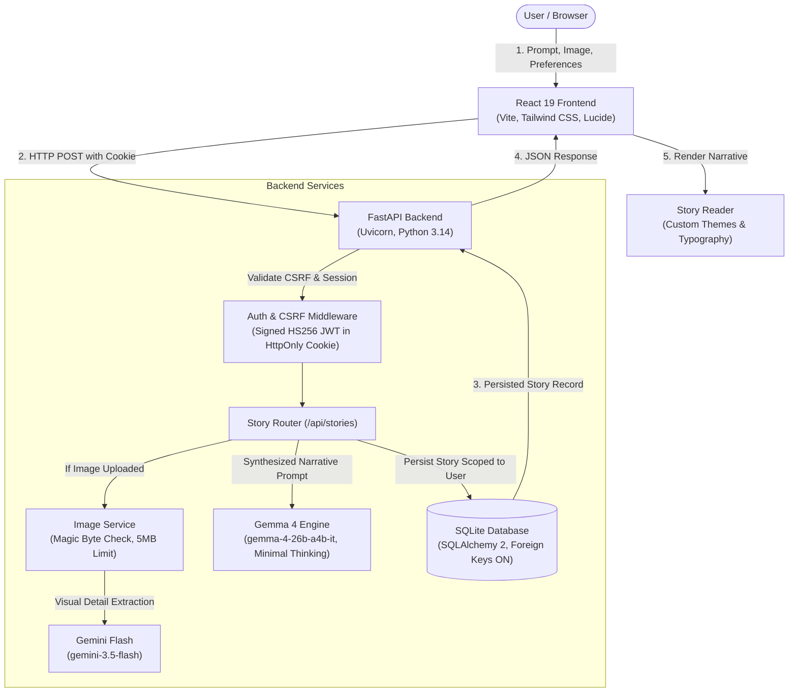
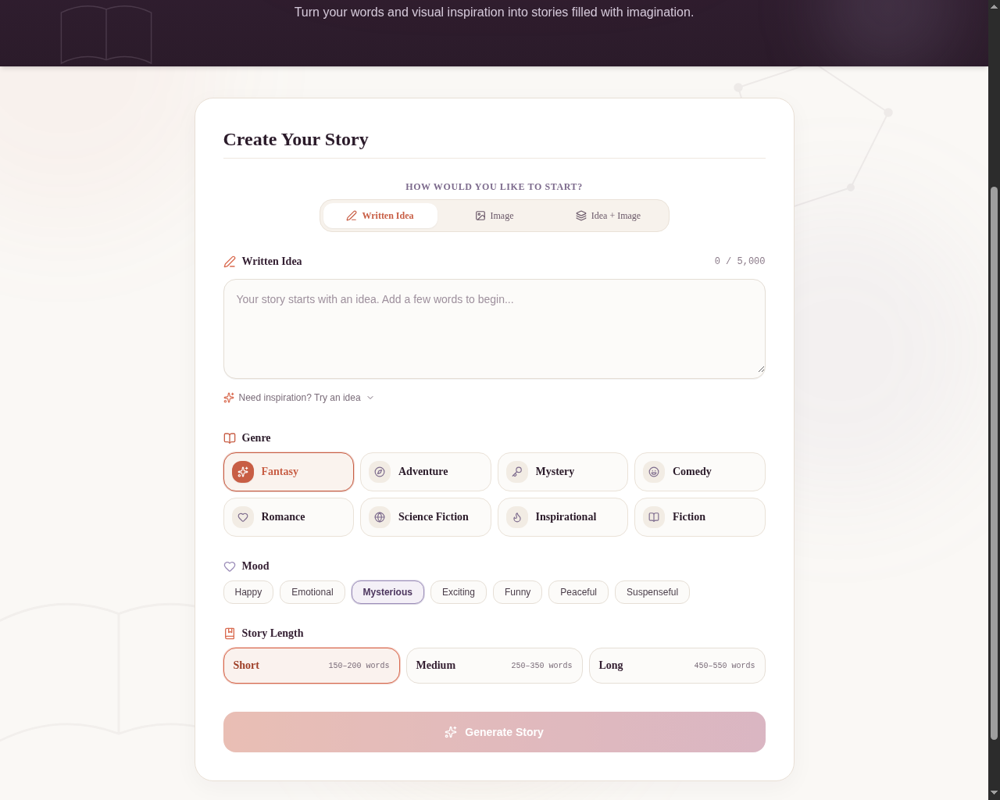
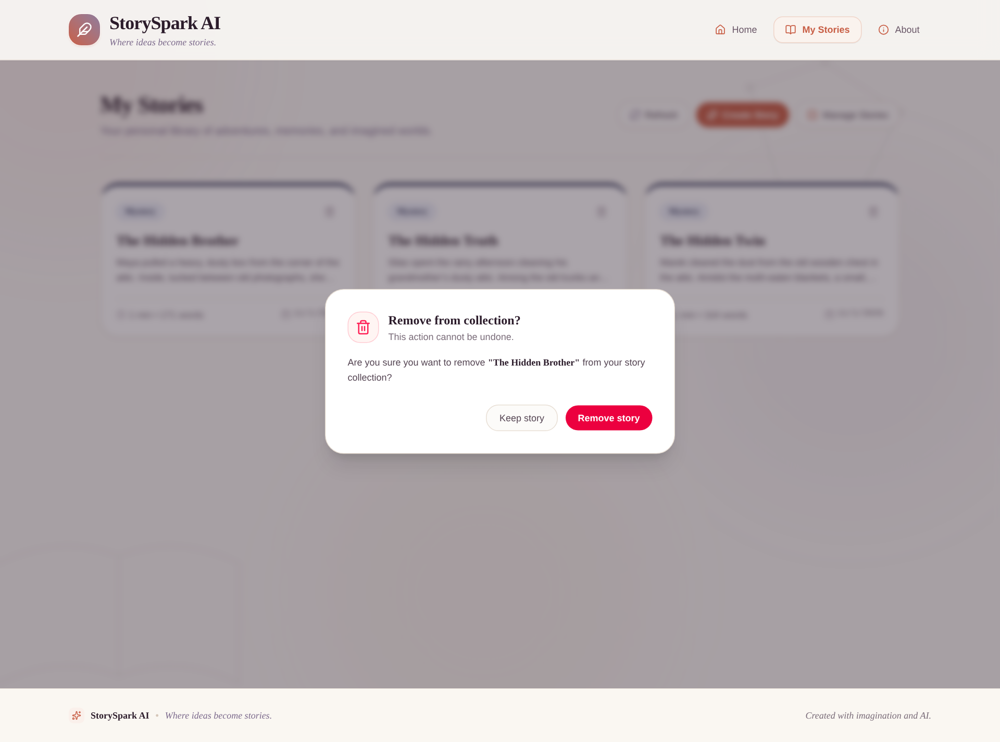
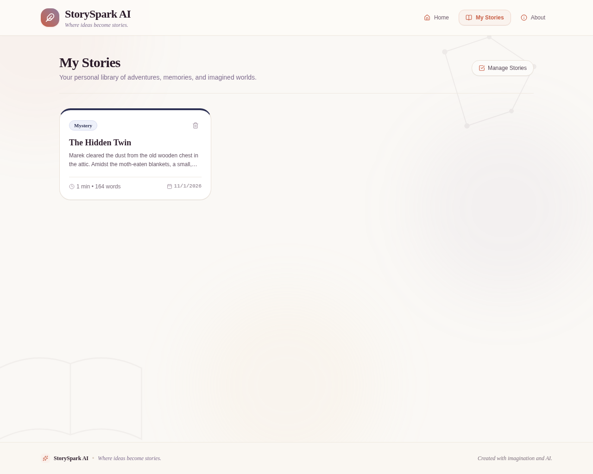
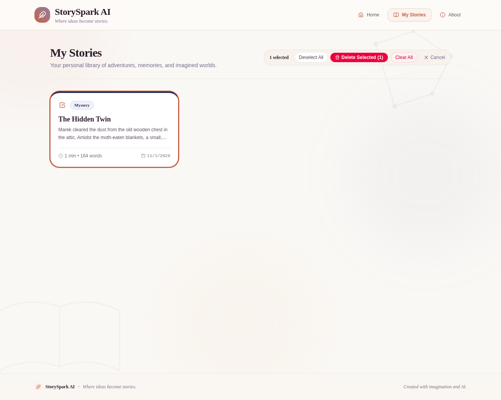
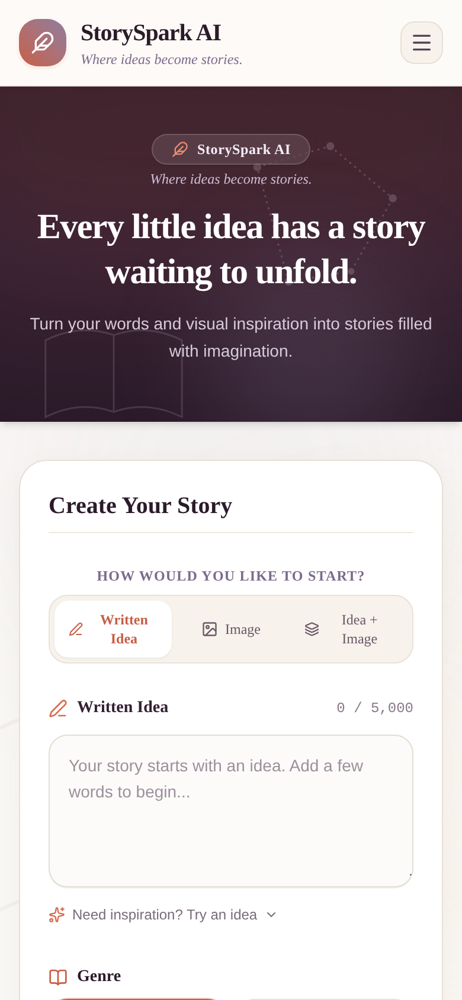
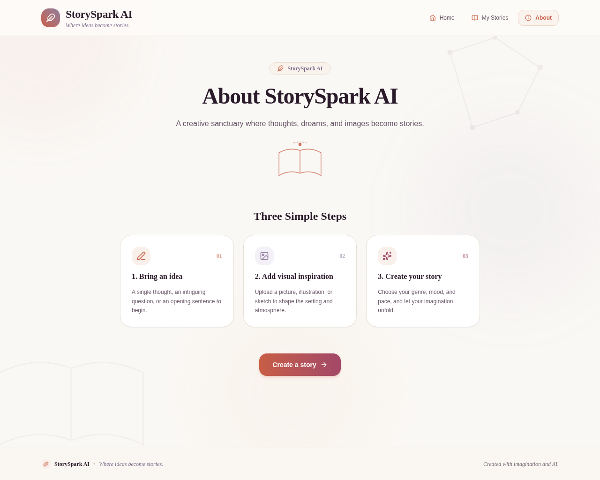

# StorySpark AI

> **Where Ideas Become Stories.**

StorySpark AI is an intelligent storytelling web application that turns creative thoughts, fragments of ideas, and uploaded images into immersive, well-crafted narratives. Powered by Google's **Gemma 4** (`gemma-4-26b-a4b-it`) and **Gemini Flash** (`gemini-3.5-flash`), StorySpark AI provides a distraction-free digital studio for writers, educators, parents, and story lovers.

Whether you start with a single intriguing sentence, an atmospheric photograph, or both, StorySpark AI extracts the narrative spark and shapes it into an engaging story tailored to your chosen genre, emotional mood, and target length.

---

## Table of Contents

- [Overview & Creative Modes](#overview--creative-modes)
- [Key Features](#key-features)
- [Architecture & Workflow](#architecture--workflow)
- [Technology Stack](#technology-stack)
- [Project Structure](#project-structure)
- [Screenshots](#screenshots)
- [Prerequisites](#prerequisites)
- [Installation & Setup](#installation--setup)
  - [1. Clone Repository](#1-clone-repository)
  - [2. Backend Setup](#2-backend-setup)
  - [3. Frontend Setup](#3-frontend-setup)
- [API Documentation](#api-documentation)
- [Database & Security Architecture](#database--security-architecture)
- [Testing & Quality Assurance](#testing--quality-assurance)
- [Known Limitations & Future Roadmap](#known-limitations--future-roadmap)
- [Project Status](#project-status)
- [Author](#author)

---

## Overview & Creative Modes

StorySpark AI tackles creative writer's block by providing three flexible, multimodal input modes:

1. **Written Idea (Text-Only)**:  
   Provide a premise, character concept, or plot hook. The application constructs an evocative story around your words.
2. **Visual Inspiration (Image-Only)**:  
   Upload an image (PNG, JPEG, or WEBP up to 5 MB). The image understanding pipeline analyzes subjects, lighting, setting, and atmosphere to ground the narrative entirely in the image.
3. **Visual Inspiration + Idea (Multimodal Synthesis)**:  
   Combine a written premise with an uploaded picture. The system synthesizes your conceptual idea with visual setting details to produce a cohesive, grounded story.

### Narrative Customization

Every story can be customized through three structured creative controls:

- **Genre**: Fantasy, Adventure, Mystery, Comedy, Romance, Science Fiction, Inspirational, Fiction.
- **Mood**: Happy, Emotional, Mysterious, Exciting, Funny, Peaceful, Suspenseful.
- **Length**:
  - **Short**: 150–200 words (punchy flash fiction).
  - **Medium**: 250–350 words (balanced story with developed scenes).
  - **Long**: 450–550 words (rich narrative with deep atmosphere).

---

## Key Features

### AI Story Generation & Vision Understanding
- **Gemma 4 Storytelling Engine**: Utilizes Google's `gemma-4-26b-a4b-it` model with optimized minimal thinking (`ThinkingLevel.MINIMAL`) for rapid, coherent narrative prose.
- **Visual Scene Grounding**: Uses `gemini-3.5-flash` to extract primary subjects, environmental details, lighting, and mood from uploaded images before feeding them into Gemma 4.
- **Strict Image Safety & Validation**: Verifies image magic bytes, MIME types (`image/png`, `image/jpeg`, `image/webp`), and limits uploads to 5 MB. Oversized or corrupted uploads are rejected before AI inference.

### Authentication & Account Security
- **Email & Password Authentication**: Secure registration and login without third-party lock-in.
- **PBKDF2 Password Hashing**: Passwords hashed using PBKDF2-HMAC-SHA256 with 600,000 iterations and unique 16-byte random salts.
- **HttpOnly Cookie Sessions**: Stateless signed HS256 JWT sessions stored in browser cookies with `HttpOnly`, `SameSite=Lax`, and configurable `Secure` flags.
- **Zero Client-Side Token Storage**: No session tokens or sensitive credentials exist in `localStorage` or `sessionStorage`.
- **CSRF Protection**: Backend middleware enforces strict `Origin` and `Referer` validation on all state-changing endpoints.
- **Protected Routes**: Creation Studio and My Stories library require authentication, automatically redirecting unauthenticated visitors to `/login` while preserving intended destination.

### Dedicated User Library (My Stories)
- **User Ownership Scoping**: Every generated story is linked to the authenticated user's ID in SQLite. Users can only access, view, and delete their own stories.
- **Timing-Safe Isolation**: Attempting to view or delete another user's story returns a uniform `404 Not Found` without disclosing story existence.
- **Search & Filtering**: Instant client-side search across titles, content, genres, and moods.
- **Transactional Bulk Deletion**: Select multiple stories to delete simultaneously in a single atomic database transaction.
- **Safe Collection Reset**: Clear-all stories feature with typed confirmation safeguard (`"DELETE"`).
- **Automatic File Cleanup**: Deleting stories cleanly removes associated uploaded image files from disk.

### Story Studio & Immersive Reader
- **Draft State Preservation**: Form prompts, genre, mood, length, and uploaded image previews persist across navigation tabs via React context.
- **Suggested Prompts**: Built-in prompt chips to inspire instant storytelling.
- **Immersive Typography Preferences**: Customize reader font family (Serif, Sans, Mono), font size (Small, Medium, Large, Extra Large), line height (Compact, Normal, Relaxed), and theme (Parchment Light, Warm Sepia, Midnight Dark).
- **Reading Time & Word Count**: Automatically calculated reading estimates and word metrics.
- **Export & Sharing**:
  - One-click text copying with feedback toast.
  - Formatted text file download (`.txt`) with metadata headers.
  - Native Web Share API integration with clipboard fallback.
- **Iterative Storycrafting**:
  - **Edit Prompt & Preferences**: Restores story parameters back to the Studio form for easy revision.
  - **Generate Another**: Re-executes the story pipeline using the same configuration.

---

## Architecture & Workflow

StorySpark AI follows a decoupled client-server architecture:



---

## Technology Stack

### Frontend
- **Framework**: [React 19](https://react.dev/) (`19.3.1`)
- **Language**: [TypeScript](https://www.typescriptlang.org/) (`7.0.2`)
- **Build Tool**: [Vite 8](https://vitejs.dev/) (`8.3.5`)
- **Styling**: [Tailwind CSS v4](https://tailwindcss.com/) (`4.3.3`) with `@tailwindcss/vite`
- **Routing**: [React Router v7](https://reactrouter.com/) (`7.18.5`)
- **Icons**: [Lucide React](https://lucide.dev/) (`1.66.0`)
- **Code Linter**: [Oxlint](https://oxc.rs/) (`1.89.0`)

### Backend
- **Framework**: [FastAPI](https://fastapi.tiangolo.com/) (`>=0.115.0`)
- **Server**: [Uvicorn](https://www.uvicorn.org/) (`>=0.32.0`)
- **Language**: [Python](https://www.python.org/) (`3.14.7` runtime compatible)
- **Database ORM**: [SQLAlchemy 2](https://www.sqlalchemy.org/) (`>=2.0.0`)
- **Data Validation**: [Pydantic v2](https://docs.pydantic.dev/) (`>=2.10.0`)
- **AI SDK**: [Google GenAI SDK](https://github.com/googleapis/python-genai) (`google-genai>=2.34.0`)
- **Authentication**: [PyJWT](https://pyjwt.readthedocs.io/) (`>=2.8.0`) and Python standard library `hashlib` (PBKDF2-HMAC-SHA256)
- **HTTP Client & Testing**: [HTTPX2](https://pypi.org/project/httpx2/) (`>=0.2.0`) and [Pytest 8](https://docs.pytest.org/) (`>=8.0.0`)

---

## Project Structure

```text
storyspark_react_app/
├── README.md                           # Comprehensive documentation
├── .gitignore                          # Git exclusions for dependencies, environments, DBs
├── screenshots/                        # Application UI screenshots
│   ├── home.png
│   ├── creation_workspace.png
│   ├── updated_homepage.png
│   ├── updated_generated_story_homepage.png
│   ├── updated_story_reader.png
│   ├── updated_story_reader_appearance.png
│   ├── my_stories.png
│   ├── my_stories_selection.png
│   ├── delete_selected_modal.png
│   ├── clear_all_modal.png
│   ├── mobile_layout.png
│   └── about.png
│
├── frontend/                           # React 19 + TypeScript + Vite frontend
│   ├── index.html                      # HTML entrypoint
│   ├── package.json                    # Frontend dependencies and scripts
│   ├── tsconfig.json                   # TypeScript configuration
│   ├── vite.config.ts                  # Vite build configuration with Tailwind v4
│   ├── .env.example                    # Frontend environment configuration template
│   └── src/
│       ├── main.tsx                    # Application mount
│       ├── App.tsx                     # Route configuration and providers
│       ├── index.css                   # Global styles and font definitions
│       ├── types/index.ts              # Taxonomy, story interfaces, and auth contracts
│       ├── services/api.ts             # API client with credentials include and error handling
│       ├── context/
│       │   ├── authContextDef.ts       # Auth context definition
│       │   ├── AuthContext.tsx         # User session provider (HttpOnly cookie sync)
│       │   ├── storySessionContextDef.ts # Studio form draft context definition
│       │   └── StorySessionContext.tsx # Story generation and draft state provider
│       ├── hooks/
│       │   ├── useAuth.ts              # Hook for authentication operations
│       │   ├── useStorySession.ts      # Hook for studio draft and active story state
│       │   ├── useStoryGeneration.ts   # Hook for generation status and error handling
│       │   ├── useReadingPreferences.ts# Hook for reader appearance (font, theme)
│       │   └── useBackendHealth.ts     # Hook for backend availability check
│       ├── components/
│       │   ├── auth/ProtectedRoute.tsx # Route guard redirecting to /login
│       │   └── story/StoryReader.tsx   # Typography, themes, actions, reading view
│       ├── layouts/AppLayout.tsx       # Header, navigation, profile pill, footer
│       └── pages/
│           ├── HomePage.tsx            # Creation studio and prompt workspace
│           ├── MyStoriesPage.tsx       # Saved story library, search, bulk deletion
│           ├── AboutPage.tsx           # Architecture and technology showcase
│           ├── LoginPage.tsx           # Email and password login view
│           └── RegisterPage.tsx        # New user registration view
│
└── backend/                            # FastAPI + SQLAlchemy backend
    ├── requirements.txt                # Python dependencies
    ├── .env.example                    # Backend environment configuration template
    ├── data/                           # Persistent local storage (git-ignored)
    │   ├── storyspark.db               # SQLite database file
    │   └── uploads/                    # Uploaded story images
    ├── app/
    │   ├── main.py                     # FastAPI app, CORS, CSRF Origin middleware
    │   ├── config.py                   # Environment configuration and validation
    │   ├── database.py                 # SQLAlchemy engine, session, foreign keys, migrations
    │   ├── models/
    │   │   ├── user.py                 # User model (email, password hash, created_at)
    │   │   └── story.py                # Story model (title, content, user_id FK)
    │   ├── schemas/
    │   │   ├── auth.py                 # Auth request/response schemas (Pydantic v2)
    │   │   └── story.py                # Story CRUD schemas and validation
    │   ├── routers/
    │   │   ├── auth.py                 # /api/auth endpoints (register, login, me, logout)
    │   │   ├── stories.py              # /api/stories endpoints (generate, CRUD, bulk)
    │   │   └── health.py               # /api/health endpoint
    │   └── services/
    │       ├── ai_service.py           # Gemma 4 generation and Gemini Flash vision logic
    │       ├── auth_service.py         # PBKDF2 hashing, JWT signing and verification
    │       ├── story_service.py        # Database operations scoped by user_id
    │       └── image_service.py        # Magic byte validation, base64 decoding, file storage
    └── tests/                          # Automated backend test suite
        ├── conftest.py                 # Test fixtures and database isolation
        ├── test_auth_endpoints.py      # Registration, login, cookie, and CSRF tests
        ├── test_auth_models.py         # User and story SQLAlchemy schema tests
        ├── test_story_authorization.py # Cross-account isolation and ownership tests
        ├── test_generation.py          # AI service parsing, prompt, and image tests
        ├── test_stories.py             # Story CRUD, bulk delete, clear-all tests
        └── test_real_api.py            # Live integration tests with Google GenAI API
```

---

## Screenshots

### 1. Story Creation Studio

*The creative workspace showing the multimodal input options (Written Idea, Visual Inspiration, or both), creative taxonomy selectors (Genre, Mood, Length), and suggested prompt chips.*

### 2. Generated Story View

*Story generated by Gemma 4 with instant action buttons: Edit Prompt & Preferences, Generate Another, Copy, and Download.*

### 3. Story Reader with Typography Customizer

*The Reader view with open customization panel: font families (Serif, Sans, Mono), sizes, line spacing, and theme modes (Light, Warm Sepia, Dark).*

### 4. My Stories Collection

*The private user library displaying saved stories with real-time search, genre and mood tags, and timestamp sorting.*

### 5. Multi-Select & Bulk Management

*Bulk selection mode allowing users to select several stories and delete them simultaneously in a single transaction.*

### 6. Clear-All Confirmation Safety Modal

*Protection safeguard requiring the user to type `"DELETE"` before permanently removing all personal stories.*

### 7. Responsive Mobile Navigation

*Optimized mobile drawer navigation with quick access to Home, My Stories, About, and profile controls.*

### 8. About & Architecture Showcase

*The About page detailing the technology stack, multimodal inspiration workflow, and mission.*

---

## Prerequisites

Before setting up StorySpark AI, ensure you have the following installed:

- **Node.js**: v18.0.0 or higher (tested with v26.8.1)
- **npm**: v9.0.0 or higher (tested with v11.19.0)
- **Python**: v3.10 or higher (tested with v3.14.7)
- **Google Gemini API Key**: An active API key with access to Google GenAI models (`gemma-4-26b-a4b-it` and `gemini-3.5-flash`). Obtain one at [Google AI Studio](https://aistudio.google.com/).

---

## Installation & Setup

### 1. Clone Repository

```bash
git clone https://github.com/Asrithalalam/storyspark_react_app.git
cd storyspark_react_app
```

### 2. Backend Setup

1. Navigate to the backend directory:
   ```bash
   cd backend
   ```

2. Create and activate a Python virtual environment:
   ```bash
   python3 -m venv venv
   source venv/bin/activate
   # On Windows: venv\Scripts\activate
   ```

3. Install required backend dependencies:
   ```bash
   pip install -r requirements.txt
   ```

4. Create the backend environment configuration file from the template:
   ```bash
   cp .env.example .env
   ```

5. Open `backend/.env` and configure your environment variables:
   ```dotenv
   # Backend Server Configuration
   ALLOWED_ORIGINS=http://localhost:5173,http://127.0.0.1:5173,http://localhost:5174,http://127.0.0.1:5174
   PORT=8000
   HOST=127.0.0.1

   # SQLite Database
   DATABASE_URL=sqlite:///./data/storyspark.db

   # Google GenAI Settings
   GEMINI_API_KEY=your_actual_gemini_api_key_here
   GEMMA_MODEL_ID=gemma-4-26b-a4b-it

   # Authentication & Security
   JWT_SECRET_KEY=your_secure_random_64_character_hex_key_here
   COOKIE_NAME=storyspark_session
   COOKIE_SECURE=False
   COOKIE_MAX_AGE_SECONDS=604800
   ```
   > **Note on `JWT_SECRET_KEY`**: Provide a cryptographically random string (at least 32 characters long). Example generation: `python3 -c "import secrets; print(secrets.token_hex(32))"`.

6. Start the FastAPI development server:
   ```bash
   uvicorn app.main:app --host 127.0.0.1 --port 8000 --reload
   ```

The backend API will be running at `http://127.0.0.1:8000`.  
- Interactive API Documentation (Swagger): `http://127.0.0.1:8000/docs`  
- Alternative API Documentation (Redoc): `http://127.0.0.1:8000/redoc`

### 3. Frontend Setup

1. Open a new terminal window and navigate to the frontend directory:
   ```bash
   cd storyspark_react_app/frontend
   ```

2. Install frontend dependencies:
   ```bash
   npm install
   ```

3. Create the frontend environment configuration file:
   ```bash
   cp .env.example .env
   ```

4. Verify that `frontend/.env` points to your backend instance:
   ```dotenv
   VITE_API_BASE_URL=http://localhost:8000
   ```

5. Start the Vite development server:
   ```bash
   npm run dev
   ```

The React frontend will be accessible at `http://localhost:5173`.

---

## API Documentation

All API routes are prefixed with `/api`. Interactive documentation is available at `http://localhost:8000/docs`.

### Authentication Endpoints (`/api/auth`)

| Method | Endpoint | Description | Auth Required |
|---|---|---|---|
| `POST` | `/api/auth/register` | Register a new user with email, password, and optional full name. Returns `UserResponse` and sets session cookie. | No |
| `POST` | `/api/auth/login` | Authenticate with email and password. Returns `UserResponse` and sets session cookie. | No |
| `POST` | `/api/auth/logout` | Clear the `storyspark_session` cookie from the client browser. | No |
| `GET` | `/api/auth/me` | Fetch the authenticated user's profile from the session cookie. | Yes |

### Story Endpoints (`/api/stories`)

| Method | Endpoint | Description | Auth Required |
|---|---|---|---|
| `POST` | `/api/stories/generate` | Generate a story with Gemma 4 (and optional Gemini Flash vision analysis) and save it to SQLite under the logged-in user. | Yes |
| `POST` | `/api/stories` | Manually save a story directly to the database under the logged-in user. | Yes |
| `GET` | `/api/stories` | List stories belonging exclusively to the authenticated user (supports `skip` and `limit` query parameters). | Yes |
| `GET` | `/api/stories/{id}` | Retrieve a specific story by ID. Returns `404` if not found or if owned by another user. | Yes |
| `DELETE` | `/api/stories/{id}` | Permanently delete a story owned by the user and clean up its uploaded image from disk. | Yes |
| `POST` | `/api/stories/bulk-delete` | Transactionally delete multiple stories owned by the user by ID array. | Yes |
| `POST` | `/api/stories/clear-all` | Transactionally delete all stories belonging to the authenticated user. | Yes |

### Health Check Endpoint

| Method | Endpoint | Description | Auth Required |
|---|---|---|---|
| `GET` | `/api/health` | Backend status check returning server health, message, and UTC timestamp. | No |

---

## Database & Security Architecture

### Relational Schema (SQLite + SQLAlchemy 2)

- **`users` Table**:
  - `id`: Integer primary key (autoincrement).
  - `email`: String(255), unique, indexed, case-normalized.
  - `hashed_password`: String(255), PBKDF2 hash.
  - `full_name`: String(100), optional display name.
  - `avatar_url`: String(500), optional avatar path.
  - `auth_provider`: String(50), `'local'`.
  - `is_active`: Boolean flag (default `True`).
  - `created_at`, `updated_at`: UTC timestamps.
  - `stories`: Relationship with `cascade="all, delete-orphan"`.
- **`stories` Table**:
  - `id`: Integer primary key (autoincrement).
  - `title`: String(200), story title.
  - `content`: Text, complete story narrative.
  - `prompt`: Text, original user text prompt (optional).
  - `image_filename`: String(255), filename of uploaded inspiration image (optional).
  - `genre`: String(50), story genre.
  - `mood`: String(50), story mood.
  - `length`: String(50), story length category.
  - `user_id`: Integer foreign key referencing `users.id` with `ondelete="CASCADE"`.
  - `created_at`: UTC timestamp.

### Security Defenses

1. **Password Protection**: Passwords are never stored in plain text. Hashing uses PBKDF2-HMAC-SHA256 with 600,000 iterations. Verification uses constant-time comparison (`secrets.compare_digest`), with dummy password hashes computed for nonexistent users to prevent timing-based user enumeration.
2. **Session Security**: Authenticated sessions rely on cryptographically signed HS256 JWT tokens transmitted exclusively in `HttpOnly`, `SameSite=Lax` cookies. JavaScript running in the browser cannot read the session token, neutralizing Cross-Site Scripting (XSS) token theft.
3. **Cross-Site Request Forgery (CSRF) Defense**: Custom FastAPI middleware inspects the `Origin` and `Referer` headers for every state-changing request (`POST`, `PUT`, `DELETE`), ensuring it matches an entry in `ALLOWED_ORIGINS`.
4. **Tenant Isolation**: All database queries for stories are scoped by `user_id == current_user.id`. Requests for another user's story yield a uniform `404 Not Found` without disclosing record existence.
5. **Uploaded File Safety**: Images are checked for valid magic bytes (`PNG`, `JPEG`, `WEBP`) before decoding, strictly capped at 5 MB, stored with randomly generated UUID filenames outside web-executable directories, and automatically cleaned up upon story deletion.

---

## Testing & Quality Assurance

The codebase includes comprehensive test suites across both backend and frontend layers:

### 1. Backend Automated Tests (`pytest`)

Execute the complete backend test suite:

```bash
cd backend
venv/bin/pytest tests/test_auth_endpoints.py tests/test_auth_models.py tests/test_generation.py tests/test_stories.py tests/test_story_authorization.py -v
```

> **Verified Test Suite Result**: **70 passed** in 2.13s (covering user registration, credential validation, JWT validation, CSRF origin middleware, image validation, Gemma 4 prompt synthesis, story CRUD, bulk operations, and cross-account authorization isolation).

To execute live tests against the Google GenAI API (requires valid key and quota):
```bash
venv/bin/pytest tests/test_real_api.py -v
```

### 2. Frontend Linting (`oxlint`)

Run the fast Rust-based Oxlint suite across all TypeScript and React files:

```bash
cd frontend
npm run lint
```

> **Verified Linter Result**: `Found 0 warnings and 0 errors. Finished in 40ms on 30 files.`

### 3. Frontend Production Build (`tsc` + `vite`)

Verify TypeScript type compilation and production asset bundling:

```bash
cd frontend
npm run build
```

> **Verified Build Result**: TypeScript compiles cleanly with zero errors; production bundle built in ~300ms.

---

## Known Limitations & Future Roadmap

### Known Limitations
- **Google Gemini Free-Tier Quota on Vision API**: The Gemini Flash vision analysis endpoint (`gemini-3.5-flash`) operates under a free-tier quota (20 requests/day). If the daily quota is exhausted, the backend returns an informative HTTP `429 Too Many Requests` alert without saving ungrounded stories. Live text-only generation with Gemma 4 remains operational.
- **Stateless JWT Revocation**: Because JWTs are self-contained and stateless, logging out instructs the browser to delete the cookie, but a previously copied token remains cryptographically valid until its 7-day expiration time.
- **Legacy Sample Stories**: The 7 initial demo stories created prior to multi-user authentication have `user_id = NULL` and remain safely stored in the database, isolated from active user collections.

### Future Roadmap
- [ ] **Multi-Chapter & Branching Stories**: Generate multi-part narratives and interactive choose-your-own-adventure decision points.
- [ ] **Audio Narration (TTS)**: Integrate browser or AI-driven voice narration to listen to generated stories.
- [ ] **EPUB & PDF Export**: Export stories with typography and uploaded artwork into beautifully formatted eBooks.
- [ ] **Character & Worldbuilding Codex**: Save recurring characters, magical items, and fictional settings across multiple story sessions.
- [ ] **Password Reset Workflow**: Add self-service email verification and password reset capabilities.

---

## Project Status

- **Core Story Generation**: Fully Implemented & Verified (Gemma 4 via Google GenAI SDK).
- **Multimodal Image Understanding**: Fully Implemented & Verified (Gemini Flash vision grounding).
- **Authentication**: Fully Implemented & Verified (Local email/password, PBKDF2, HttpOnly JWT cookies).
- **My Stories Management**: Fully Implemented & Verified (Single deletion, bulk deletion, clear-all).
- **Reader & Customization**: Fully Implemented & Verified (Font family, size, line spacing, themes, copy, download, share).
- **Testing & Verification**: 70/70 backend tests passing, 0 lint warnings/errors, clean production build.

---

## Author

- **Author**: Asritha Lalam
- **GitHub**: [@Asrithalalam](https://github.com/Asrithalalam)
- **Repository**: [Storyspark_AI](https://github.com/Asrithalalam/Storyspark_AI)
